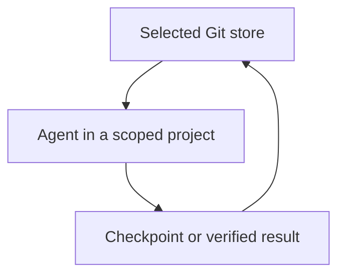

# Hars-Mem

A Git-backed second brain for the work your agents share.

I run agents across different chats, tools and machines. I wanted them to start from the same decisions, see who was already working on a task, and leave something the next agent could pick up. So I built one place they can all read and write back to.

**[Set up your brain](ONBOARDING.md)** | [See how work moves](WORKFLOW.md) | [Bring an existing repo](ADAPT.md)

## What lives where

| In your brain | In each project |
| --- | --- |
| Your rules, decisions, task board, checkpoints and summaries that link back to evidence. | The repo, its own instructions and skills, working logs and tests. |

Your brain tells an agent which project it owns, what has already been decided and where to check what is true today. The agent works in the project and saves a checkpoint or a verified result back to the board.

## Start with your own store

Use a private GitHub repo or local Git. Follow the setup guide, point your first agent at the store, and give it one task. Always-on agents and fresh chats both start from the same rules and board.

Use the [guided interview](ONBOARDING.md#bring-over-one-project) to review a selected import or paste the handoff prompt into an existing chat.

Use [hosted access](HOSTED.md) from a browser or a read-only connector. To look up saved work, see [how to find written knowledge](ADAPT.md#find-written-knowledge).

## The handoff we tested

We switched between two local Git stores. A fresh agent got the new address and project scope. It found the saved checkpoint, claimed the same task and finished it. [Run the acceptance tests](tests/acceptance.mjs).
